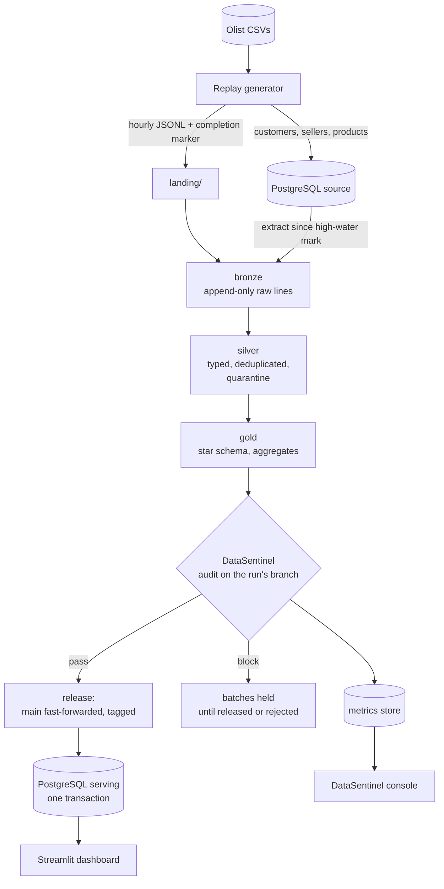
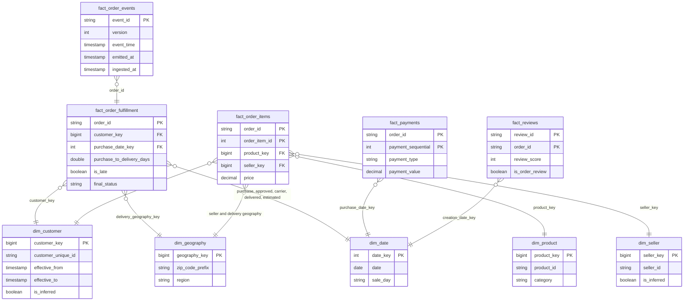

# Chronos

[](https://github.com/RangeR107/ChronosLakehouse/actions/workflows/ci.yml)

A batch lakehouse that replays real Olist marketplace orders as a late, messy daily event feed.
It builds a star schema from that feed and publishes only audited releases. Everything runs on
a laptop, for free: PySpark and Apache Iceberg, Airflow and PostgreSQL in Docker. It is designed
to move to S3 and Glue, but it was never deployed to AWS.

## The results, in one minute

- **Late, duplicated and wrong events still give the right answer.** The feed delays events,
  sends them twice, swaps their order, sends wrong values that are corrected later, and
  delivers files and master rows late. After the last delay lands, every business table
  equals a reference built straight from the Olist files with DuckDB, row by row.
  - The truth test checks this on a 60-day real slice (2,679 orders) and on a hand-built
    fixture in CI (`tests/truth/`).
- **Nobody ever sees a half-built day.** Each run writes on its own Iceberg branches. Its
  audit runs there, and only a passing run becomes a release: every table moves to it
  together, and the dashboards' PostgreSQL loads it in one transaction.
  - A run that crashes halfway leaves the dashboards untouched, and rerunning a published day
    republishes nothing (`tests/scenarios/`).
- **Bad days are caught and held back.** The quality gate is called DataSentinel. On a held-out
  year with 180 injected anomalies it detected 175 (97%), and it falsely blocked 3 of 155 clean
  days (1.9%). Black Friday 2017 was published with a warning instead of a false block.
  - What it missed, why, and what changed since is in the
    [evaluation report](docs/evaluation/report.md).
- **Every choice is written down,** with the alternatives:
  [docs/decisions.md](docs/decisions.md).

## How it works



- **One business date at a time.** Airflow's `chronos_daily` (or `python -m jobs.run_day`)
  runs the steps in order: wait for the marker, register files, extract dimensions, open the
  run's branches, land to bronze, bronze to silver, build dimensions, build facts, recompute
  only the months the changes touched, audit, publish, serve, clean up, notify.
- **Silver and gold are Iceberg format-version 2 tables.** Every MERGE inserts or updates only
  what changed, after deduplicating on `event_id`, so any day can be rerun safely.
- **DataSentinel's checks:**
  - Great Expectations for keys and grain, referential integrity, and reconciliation from
    silver to gold.
  - A schema contract per `schema_version`, with quarantine.
  - Completeness of the landing files against the producer's marker.
  - Robust volume scores against the same weekday, and binomial tests for known source
    defects.
  - Drift by PSI, null rates, and freshness.
  - Each failure blocks, warns or quarantines, as the spec's severity table says.

### The star schema



- **`fact_order_fulfillment`** is an accumulating snapshot: one row per order, filled in as
  its milestones arrive.
- **`dim_customer`** is SCD Type 2. A customer an order names before their master row arrives
  gets an inferred member: a placeholder with the key the real row will have, overwritten in
  place when it lands.
- **`dim_date` and `dim_geography` are role-playing,** each used for several dates or places.
- **`fact_order_events`** is the ledger of every event version, with all three clocks: when it
  happened, when it was sent, and when it was received.
- **The design itself,** including the business questions and every metric's definition, is
  in [docs/spec.md](docs/spec.md).

## Run it

You need macOS or Linux, **Python 3.11**, **Java 17** (Spark 3.5 doesn't run on newer Java),
**Docker**, and about 2 GB of disk. The `Makefile` finds Java 17 with macOS's `java_home`; on
Linux, set `JAVA_HOME` to a Java 17 install first.

### 1. Get the data

Download the [Brazilian E-Commerce Public Dataset by Olist](https://www.kaggle.com/datasets/olistbr/brazilian-ecommerce)
from Kaggle (a free account is needed). Unzip it so these files sit in `data/raw/olist/`:

```text
olist_customers_dataset.csv        olist_order_reviews_dataset.csv
olist_geolocation_dataset.csv      olist_orders_dataset.csv
olist_order_items_dataset.csv      olist_products_dataset.csv
olist_order_payments_dataset.csv   olist_sellers_dataset.csv
product_category_name_translation.csv
```

The data is published under CC BY-NC-SA 4.0 (non-commercial, share-alike); credit to Olist. It
is never committed to this repository.

### 2. Set up and start the database

```bash
make setup
```

```bash
make db
```

This creates `.venv` with the pipeline and its tools, and starts PostgreSQL 16 in Docker on
port 5433.

### 3. Run the demo (about 10 minutes)

```bash
make demo
```

It replays 1 to 30 January 2017 through the whole pipeline, one business date at a time
(`jobs/demo.py`). The first run also fetches the Iceberg runtime for Spark (about 45 MB, once). The feed carries the spec's defects, so events arrive late, twice, out of
order and briefly wrong. Between Spark's own log lines, it prints one line per date (this is
an excerpt of a real run):

```text
Replaying 2017-01-01 to 2017-01-30 into chronos_demo and lake/demo/ ...
2017-01-01  published release_2017-01-01  events     0  warnings 0
...
2017-01-09  published release_2017-01-09  events    16  warnings 1
2017-01-10 blocked by ['landing completeness:unlisted_files']
2017-01-10  BLOCKED  2017-01-10: landing completeness:unlisted_files
            Nothing was published; the date's lines are held.
            Released (a stray resend, checked): the next date takes them in.
2017-01-11  published release_2017-01-11  events    57  warnings 1
2017-01-12  published release_2017-01-12  events    42  warnings 1  (marked incomplete)
...
2017-01-30  published release_2017-01-30  events   258  warnings 1

releases: {'blocked': 1, 'published': 29}; batches a block held: {'published': 1}; dashboards now serve release_2017-01-30
```

- **`events`** is the number of event lines that landed for the date. Olist's first orders
  are on 5 January, so the first four releases are empty.
- **On 10 January** the producer resends a file under a name its completion marker doesn't
  list. DataSentinel blocks the date, nothing is published, and the date's data is held. The
  demo then releases it, as the runbook says a person would, and 11 January's release
  includes it. To make that decision yourself, run the demo with `--ask` (below): it pauses
  on a block while you look at it in the console.
- **`warnings`** are mostly the checks warming up. In its first weeks DataSentinel has only
  one or two earlier dates of the same weekday to compare with, so the volume and freshness
  checks warn often. During the 28-day warm-up they can warn, but never block.
- **`(marked incomplete)`** means the release was published but flagged. Here the reason is
  the freshness warning: the date's newest event was older than usual. The dashboards say
  when the data they show is incomplete.

The demo writes only to its own database (`chronos_demo`) and folder (`lake/demo/`), and
starts from scratch each time.

To decide blocks yourself, run it with `--ask`. On a block it pauses and asks whether to
release the held lines, reject them, or keep them held:

```bash
JAVA_HOME=$(/usr/libexec/java_home -v 17) .venv/bin/python -m jobs.demo --fresh --ask
```

### 4. Look at the results

```bash
make dashboard
```

```bash
make console
```

- **The dashboard** (http://localhost:8501) shows the late-delivery rate and the delivery
  promise by month and region. It reads the release that PostgreSQL last served.
  - **After the demo it shows 238 delivered orders, none late.** That is Olist's real record:
    243 orders were delivered by 30 January 2017, none of them late. The other 5 deliveries
    are events the feed is still holding back as late arrivals.
  - **Its restatement report** shows how published numbers moved as late and corrected events
    landed.
- **The DataSentinel console** (http://localhost:8502) shows every release and block, the
  check history per table, the quarantined lines and the alerts.
  - In **Alerts and blocks** you'll find the 10 January block, and each date's run summary.
  - In **Open problems** you can see which releases are marked incomplete, and why.

For a fuller picture, run `make demo DAYS=90` (about 35 minutes). It replays to 31 March
2017, where Olist's late deliveries begin:

- **The dashboard then shows 3,996 delivered orders, 52 late (1.3%).** In March the late rate
  is about 3% in the South and the Northeast. Olist's file has 4,016 orders delivered by that
  date, with the same 52 late; the other 20 deliveries are still held back by the feed.
- **1 February is blocked too, once the warm-up has ended.** The known-defect check flags
  orders without items, a false alarm on real data that the decision log records under the
  warm-up fix. The demo releases it and prints that nobody checked it.

### 5. Run the tests

```bash
make test
```

```bash
make truth
```

- **`make test`** runs lint and every test: unit tests, the late-data scenario tests, and the
  truth test on the fixture. With the Olist files present it also runs the truth test on the
  real slice: 160 tests in about 55 minutes on a laptop. CI has no Olist files and runs the
  other 146, in about 40 minutes.
- **`make truth`** is the truth test on the real Jan to Feb 2017 slice, with the spec's
  defects on. It takes about 30 minutes and needs the Olist files.

### Optional: Airflow

```bash
make airflow
```

Open http://localhost:8080 (user `airflow`, password `airflow`), unpause `chronos_replay`,
`chronos_daily` and `maintenance_weekly`, then backfill dates strictly in order:

```bash
docker compose exec airflow-scheduler airflow backfill create --dag-id chronos_replay --from-date 2017-01-01 --to-date 2017-01-15 --max-active-runs 1
```

The Airflow lake is separate from the demo's (`lake/airflow/`, database `chronos`). Set
`CHRONOS_SLACK_WEBHOOK` in `.env` to have run summaries and failures posted to Slack
([docs/runbook.md](docs/runbook.md)).

### Optional: the evaluation (about 5 hours)

```bash
JAVA_HOME=$(/usr/libexec/java_home -v 17) .venv/bin/python tests/evaluation/evaluate.py run --until 2018-09-03
```

```bash
.venv/bin/python tests/evaluation/evaluate.py report --period test
```

It replays January 2017 to August 2018 with 180 injected anomalies into its own database
(`chronos_eval`), then scores what DataSentinel caught.

## Repository map

| Folder | What's in it |
| --- | --- |
| `generator/` | The source system: replays Olist as hourly files and master rows, with reversible defects and the evaluation's anomalies |
| `contracts/` | The event schema for each `schema_version` |
| `jobs/` | The pipeline steps, one function each, plus the local runner and the demo |
| `sentinel/` | DataSentinel: checks, scores, the audit, releases, alerts and the console |
| `dags/` | The Airflow DAGs: `chronos_daily`, `chronos_replay`, `maintenance_weekly` |
| `sql/` | PostgreSQL schemas: the source, the metrics store |
| `dashboard/` | The Streamlit dashboard |
| `tests/` | Unit, scenario and truth tests, the DuckDB reference build, and the evaluation harness |
| `tools/` | The reference scripts that measured the spec's numbers |
| `docs/` | The spec, decisions, runbook, per-phase notes, evaluation report and write-up |

## Read more

- **[docs/writeup.md](docs/writeup.md):** the project in two pages, covering what was hard and
  what was learned.
- **[docs/spec.md](docs/spec.md):** the full design: business questions, metric definitions,
  the event model, the data model and the checks.
- **[docs/decisions.md](docs/decisions.md):** every change to the spec, with why and what else
  was considered.
- **[docs/evaluation/report.md](docs/evaluation/report.md):** DataSentinel's held-out
  evaluation.
- **[docs/runbook.md](docs/runbook.md):** what to do when a day fails, is blocked, or a
  publish dies midway.
- **`docs/phase-N-notes.md`:** what each phase built, how to run and test it, and interview
  questions with answers that point to the code.

## Limits

- **Never deployed to AWS.** The cloud design (S3, Glue 5.1, the Glue Data Catalog, Athena) is
  in the spec, but Phase 4 was skipped to use no AWS credits. Its estimated cost is in the
  decisions log.
- **The truth test has run on a 60-day slice, not on the full history.** The evaluation
  replayed 99,092 orders through the pipeline, but with anomalies, so it isn't a truth replay.
- **About 100,000 orders is small.** No scale is claimed beyond what ran.
- **The evaluation covers six anomaly types,** not every way data goes wrong. Three candidate
  fixes it suggested were not made, because there is no second held-out period to test them on.
